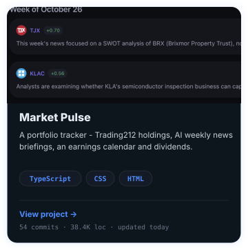

<!-- profile summary and project cards live in one centered block so GitHub
     doesn't insert a paragraph-sized gap between them - the only vertical gap
     is the transparent padding baked into the SVGs (~20px, matching the gap
     between the cards inside profile.svg). profile.svg is theme-adaptive, so a
     single  covers both light and dark. The profile  is wrapped in
     <a href="https://github.com/T0m2sT"> because GitHub auto-links any
     un-anchored README image to its raw blob - wrapping it in a link to the
     profile suppresses that, so clicking the banner never opens the SVG source. -->
<h1 align="center">Pedro Tomás Teixeira</h1>

BSc in Informatics and Computer Engineering @FEUP | ACM Vice President &amp; Head of Cybersecurity Dep. | xSTF Member

