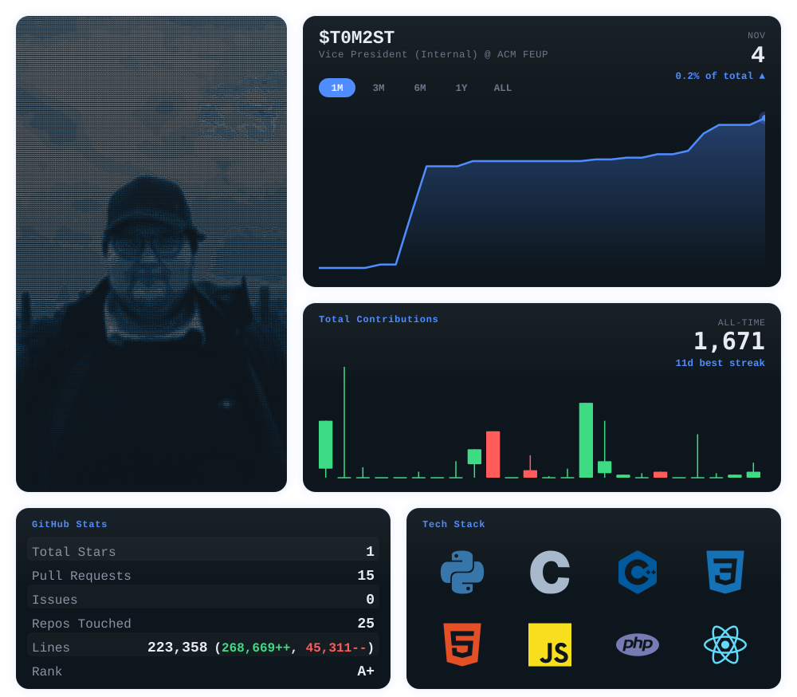

<!-- One centered block per section so GitHub adds no paragraph gap. Each image is
     wrapped in a link (GitHub otherwise links bare images to their raw blob).
     Images use align="top" so stacked slices touch with no baseline gap; the lower
     terminal is one window cropped into slices so each project keeps its own link
     (built by .github/scripts/build-lower.mjs). -->

&nbsp;&nbsp;

